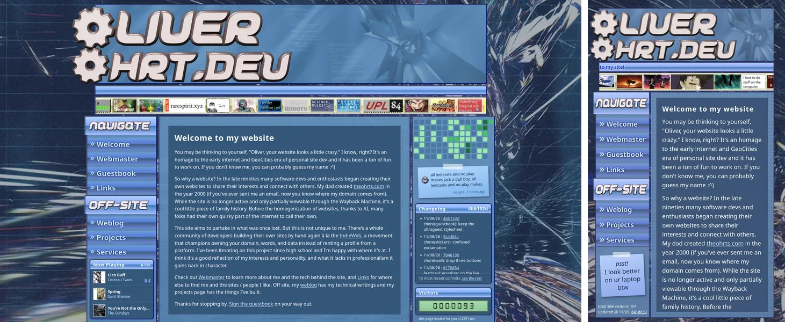

# ohrt.dev

<p align="center">
  <a href="https://ohrt.dev"></a>
</p>

<p align="center">
  <a href="https://github.com/Lavanic/ohrt.dev/actions/workflows/deploy.yml"></a>
  <a href="https://ohrt.dev"></a>
  <a href="https://github.com/Lavanic/ohrt.dev/commits/main"></a>
  <a href="https://astro.build"></a>
  <a href="https://pages.github.com"></a>
</p>

My personal website, a GeoCities-era homage with a modern build underneath. Written in [Astro](https://astro.build), every page is a plain static file. The visitor counter, contribution graph, changelog and status note are fetched at build time and refreshed in the browser.

## Development

```sh
npm install
npm run dev
```

Runs at `localhost:4321`. `npm run check` type-checks and `npm run format` runs Prettier.

## Deployment

Automatically deployed to GitHub Pages on every push to `main`, plus a daily rebuild so the live widgets stay fresh.
